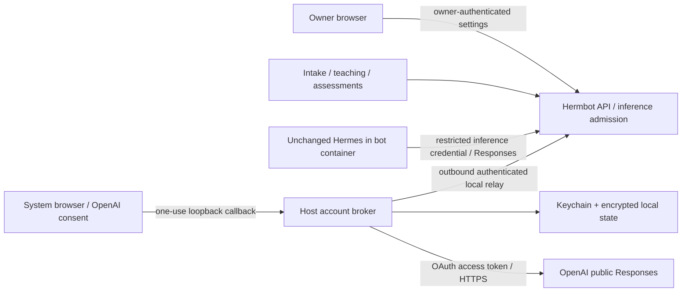

# ChatGPT subscription authentication — researched implementation plan

**Superseding owner direction, November 2:** add a separate direct Codex subscription connection alongside API-key providers. The owner explicitly rejected delegating login to Hermes and requested Hermbot-owned Codex authentication. The earlier public Responses plan-sharing flow below is preserved as historical research and remains a distinct `chatgpt_oauth` type; it is not silently converted into `codex_oauth`. Current implementation, research revisions, tests, rollout and real-account gates are recorded in the [direct Codex review](CHATGPT-SUBSCRIPTION-AUTH-REVIEW.md#direct-codex-connection).

Status: implemented and deployed locally November 2, 2026; real-account acceptance pending owner OpenAI consent/model verification. [Implementation, security review, setup and evidence](CHATGPT-SUBSCRIPTION-AUTH-REVIEW.md). The sections below preserve the researched design and gates, including limitations that require real provider acceptance. Requested to unblock model use after the current API credentials became unusable. This is a prerequisite for continuing Phase 6.2 acceptance, not a new numbered roadmap phase. Phase 6.1, connected-service coordination, mobile use, VM isolation and evaluations retain their existing sequencing.

## 1. Outcome and constraints

The owner connects an eligible ChatGPT account in Workspace settings → Providers, authorizes plan usage in OpenAI's browser flow, verifies a permitted model, and selects it for teammates and supported application jobs. Account credentials remain outside bot containers. Existing API providers continue working. Hermes source stays unchanged.

Use the current official Sign in with ChatGPT public-client flow for eligible Responses requests. Do not import Codex CLI credentials, impersonate its registered client, or use its private backend endpoint. Calling this “Codex limits” would overstate what is established: this flow uses ChatGPT plan usage/credits according to the account's grant and applicable limits. Confirm the actual account's eligibility and allowance behavior before presenting it as usable. Local execution alone does not establish approval for every private/business application. Hosted/commercial distribution needs a separate eligibility review. [Official integration choices](https://developers.openai.com/siwc/quickstart), [local-project introduction](https://developers.openai.com/cookbook/articles/sign-in-with-chatgpt).

Connecting a model account does not log someone into Hermbot, connect their Slack/Google/GitHub accounts, or authorize external changes. Existing owner sessions, grants, task permissions and review decisions keep their own authority.

## 2. Implementations studied and decisions drawn from them

| Primary reference | Observed implementation | Decision for Hermbot |
| --- | --- | --- |
| [OpenAI Sign in with ChatGPT DevKit / Paste Perfect](https://github.com/openai/sign-in-with-chatgpt-devkit) | Local trusted process owns OAuth, storage and inference; UI sees safe connection state. | Follow the public contract and separate secrets from UI and agents. |
| [DevKit security design](https://github.com/openai/sign-in-with-chatgpt-devkit/blob/main/docs/security.md) | OS-backed encryption, protected files, interprocess locking, atomic replacement, pending encrypted rotations during identity-verification outages. | Preserve received rotations before dependent verification; distinguish unavailable verification from an invalid identity. |
| [DevKit license](https://github.com/openai/sign-in-with-chatgpt-devkit/blob/main/LICENSE) and [public types](https://github.com/openai/sign-in-with-chatgpt-devkit/blob/main/packages/local/src/types.ts) | Noncommercial license; its public inference helper accepts text messages rather than arbitrary agent tool/image streams. | Do not vendor this SDK under an assumed permissive license. Write the integration from the documented protocol with appropriately licensed dependencies; do not mistake the text demo for a complete harness gateway. |
| [OpenClaw OAuth ownership](https://github.com/openclaw/openclaw/blob/main/docs/concepts/oauth.md) | One authoritative credential record; explicit profiles; locally owned refreshes do not fall back to unrelated CLI token files. | One refresh owner per connection; no automatic credential discovery or stale backup restoration. |
| [OpenClaw Codex auth bridge](https://github.com/openclaw/openclaw/blob/main/docs/plugins/codex-harness-reference/auth.md) | Long-lived token stays with the application; child auth is explicit; conflicting API-key inheritance is removed. | Keep both OpenAI access and refresh tokens in a broker; give a runtime only a restricted Hermbot inference credential. |
| [Pi current OpenAI provider](https://github.com/earendil-works/pi/blob/main/packages/ai/src/providers/openai.ts), [current OAuth flow](https://github.com/earendil-works/pi/blob/main/packages/ai/src/auth/oauth/openai-chatgpt.ts), [legacy provider](https://github.com/earendil-works/pi/blob/main/packages/ai/src/providers/openai-codex.ts) | Current subscription provider uses public Responses; legacy Codex route is separate. OAuth credentials filter out Decisions classifiers. | Separate authentication type from wire protocol and feature support. Do not advertise Decisions with subscription credentials. |
| [Hermes provider documentation](https://hermes-agent.nousresearch.com/docs/integrations/providers) plus read-only installed-source inspection | Native subscription auth exists, while named custom providers can explicitly select Responses. | Preserve Hermes as the harness; configure its existing named-provider interface to reach Hermbot's broker boundary. |
| [Codex issue #10332](https://github.com/openai/codex/issues/10332) | A reported multi-process refresh race illustrates reuse of rotating credentials. This historical issue is not proof of a current unfixed Codex bug. | Test concurrent refreshes and crash recovery; a process-local mutex is insufficient. |

These upstream `main` references are moving research sources, not pinned dependencies. At implementation, record exact revisions for compatibility fixtures and pin all adopted packages with hashes/licenses. No third-party project was installed or executed during this research.

## 3. What the existing code requires us to change

Verified by repository inspection, excluding `architecture/`:

| Area | Current behavior | Required change |
| --- | --- | --- |
| `backend/registry.py`, `models.py`, `product.py` | Provider means base URL, model list and encrypted static secret; public settings always say a key is configured. | Discriminated auth kind and transport; safe connection status/capabilities; conditional validation. |
| `registry.enqueue`, `provisioning.py`, `containers.py` | Provider secret is copied into provisioning payloads, decrypted, then passed in runtime environment. | OAuth providers carry a connection reference and a restricted local inference credential only. Never put their token set in operations/outbox or Docker metadata. |
| `docker/hermes_bootstrap.py` | Rewrites native model configuration to plain `provider: custom`, sets API-key environment. | For this auth kind, configure a named custom Responses provider pointing to the internal inference route. Remove conflicting real API keys on that route. |
| `backend/work_intake.py` | Message interpretation posts to `/chat/completions`, uses structured output and a read-context function loop. | Add an explicit Responses implementation that preserves the validated interpretation schema and lookup loop. |
| `backend/teaching.py` | Teaching/refinement posts reviewed images and instructions to `/chat/completions`. | Use supported image/text Responses requests and preserve evidence, revision and publication fences. |
| `backend/decisions.py`, `execution_monitor.py` | Explicit `/decisions` or structured-chat assessment mode. | Capability validation; retain actual Decisions mode for a separately configured compatible API provider. Add explicitly named structured Responses assessment mode if selected. |
| `backend/app.py`, `native.py`, lifecycle/provisioning and runtime adapter | Existing authentication, task control and private transport. | Add authenticated broker relay, runtime inference admission, cancellation and lifecycle revocation using existing authority patterns. |
| `web/src/Management.tsx`, shared API types/settings fixtures | Only API-key provider form and generic key status. | Add connection flow, safe account status, account-specific model choices and appropriate assessment choices. |
| Compose/configuration, requirements, scripts, documentation/tests | Model keys shared through existing app environment; no native local account broker. | Add a separately launched host broker, narrow pairing secret, locked dependencies and runbook; preserve existing API-key setup. |

The installed image's base is pinned at `nousresearch/hermes-agent@sha256:d4da4a40cd7a28aba983775d9fd31d94cbf153eeb0cb9e844d6d0f612b7c24db`. `/opt/hermes` has no Git metadata. Inspection confirms named custom `api_mode` support in `hermes_cli/runtime_provider_custom.py`. Plain `provider: custom` deliberately ignores an explicit Responses mode for an unrecognized proxy hostname; simply adding `api_mode` to today's bootstrap would fail. The named-provider path must be tested. Native Responses code already supports streaming/history but can emit fields this subscription route rejects. Static inspection establishes feasibility, not protocol acceptance.

Also audit native auxiliary calls: summarization/compaction, vision, planning and any model-using helper or scheduled execution. They must either use this same explicit route or report a separately required provider. No helper may quietly inherit the exhausted key or borrow host credentials.

## 4. Selected architecture and trust boundary

Use a small Hermbot-owned Python broker on the Mac, with the current backend dependencies where suitable. Add a maintained JWT verification library rather than implementing signatures. The broker holds a dedicated vault key in macOS Keychain and encrypted connection state in an owner-only application directory outside the repository and Docker build context. Use an explicit OS backend; unavailable secure storage is an error, never a plaintext fallback.

The broker initiates an authenticated persistent WebSocket connection to Hermbot's existing `127.0.0.1:8780` API. This lets container-side requests reach the host broker without publishing a credential service to the LAN, assuming Unix socket mounting works across Docker Desktop, or adding a second relay service. The short-lived OAuth callback is the broker's only inbound listener and binds `127.0.0.1` on an available port.

The API routes model requests and sees the same task content it already manages. It receives safe account metadata, never OpenAI tokens or the vault key. The worker, supervisor, bot, web browser and database backups also receive no OAuth token material. The broker has no Docker socket, general database credential, owner token or connected-app credentials.

Pair the broker with this one local Hermbot installation using a separate random transport secret in protected host storage and an API-only secret mount. Do not use owner, bot, supervisor or connector credentials as the pairing secret. Reject unauthenticated connections before parsing large messages; reject browser-origin WebSocket handshakes on the internal bridge. Validate exact configured loopback target/Host, protocol version, connection epoch, frame sizes, request IDs and deadlines. Broker reconnection invalidates old in-flight routing; never replay an unacknowledged generation automatically.

For this local deployment, a loopback-only authenticated bridge is acceptable within the trusted host boundary. Any remote transport requires TLS and a separately reviewed pairing/deployment design. Keep it disabled for remote targets in this implementation.

### Explicit threat model

Protect against malicious tool output/prompt injection asking for tokens; a compromised bot stealing the owner's account session; stolen PostgreSQL/application backups; token-bearing logs/crash reports; malicious websites initiating login or using the local relay; account substitution; concurrent refresh; and quota amplification by multiple bots.

Host administrator/root and arbitrary code already running as the owner's trusted host user remain outside the isolation guarantee. API compromise can consume the connections assigned to this workspace, although it cannot read their raw OpenAI tokens. A bot can consume within its allowed inference scope; proxying cannot prove that an arbitrary model request faithfully serves the owner. Bound that exposure with assignment, revocation, concurrency and request budgets.

Keychain is not a claim of process-level immunity. Python keyring explicitly documents that scripts using the same trusted Python executable may access its secrets. Use a dedicated broker installation, explicit macOS backend and reviewed Keychain ACL; record this limitation. Strong isolation from other hostile owner-UID code would require a signed/hardened broker or a stronger OS boundary and a separate acceptance gate. [Keyring backend security](https://keyring.readthedocs.io/en/latest/#security-considerations).

## 5. Sign-in, identity and account lifecycle

Implement against [registration/sign-in](https://developers.openai.com/siwc/token-sharing-open-source/sign-in), [account/session management](https://developers.openai.com/siwc/token-sharing-open-source/profiles-and-sessions), and [OAuth Security BCP](https://datatracker.ietf.org/doc/html/rfc9700). These requirements are part of the contract, not optional UI polish.

1. Owner starts a POST from authenticated Providers settings. Reuse the same-origin protections and bind the pending attempt to the initiating owner session and intended connection. Only one active sign-in attempt per connection; cancellation and expiry release its listener. A bot credential can never start or finish sign-in.
2. Broker persists a stable random installation host ID. New registration uses `dynamic_agent_client`, app name `Hermbot`, and this host ID; reconnect uses the saved issued client ID. Keep a pending new connection separate from a working one.
3. Start the callback before opening the system browser. Generate fresh high-entropy PKCE S256 verifier/challenge, state and nonce. Request only documented identity and plan-use scopes for the fixed OpenAI resource. Do not embed login inside the bot's browser or ask for a password/token paste.
4. Use the exact `http://127.0.0.1:<port>/auth/callback` URI for authorization and exchange. Port may vary; callback host/path must remain stable. Strictly validate method, Host, path, state, parameter uniqueness, TTL and one-use consumption, including denial/error callbacks. Reject extra callbacks and authorization response mix-ups.
5. Persist a newly issued client ID before exchanging the one-use code. Reject changed IDs during reconnect. Exchange only at the official token endpoint; no client secret. Keep the verifier/code out of URLs except the provider's unavoidable authorization-code callback, and redact that callback's query from access logs.
6. Validate ID-token signature against constrained official JWKS, allowed algorithm, issuer, issued-client audience/authorized party, times and nonce. Reject `none`, wrong audience, unexpected key URLs and subject changes during reconnect. Never trust an unverified decoded JWT. Treat provider metadata as opaque. Use a standards library for cryptographic verification. [PyJWT verification primitives](https://pyjwt.readthedocs.io/en/stable/usage.html).
7. Verify granted plan-use scopes. Identity-only consent becomes “Signed in; plan usage not enabled”; it must not enable inference. An unavailable JWKS service preserves the pending encrypted state and reports verification pending. A confirmed invalid identity never becomes active.
8. Store registrations separately by validated issuer/subject and issued client ID; email is a display label, not a merge key or workspace identity. Two registrations for the same email can have different workspace bindings. Every request names one immutable local connection reference; never read a mutable global “active account” while routing another bot's request.
9. Return safe status to the initiating owner. Show account label, registration label, plan-use permission, model availability and Manage usage. Preserve the old selection if replacement sign-in fails. Switching a selected connection increments its authority epoch and requires current-request revalidation.
10. Disconnect first blocks admission and cancels affected streams. Attempt revocation using official discovery, then remove local tokens; retain nonsecret registration identity for reconnect. Report local removal and remote revocation independently. Network failure must not be shown as confirmed remote revocation. “Disconnect account” is distinct from Hermbot browser logout; background routines need the connection until explicitly disconnected. Document this clearly.

Callback pages contain no third-party scripts/assets, return no-store and restrictive CSP/referrer headers, and show only safe success/failure text. Broker opens authorization URLs itself; token hints do not pass through web analytics or UI state. Browser polling only reads the pending attempt's safe status.

## 6. Credential storage and refresh correctness

Use a local SQLite vault with whole secret records encrypted using existing `cryptography` primitives and a dedicated Keychain-held random key. Store host identity and safe metadata separately. Force owner-only directory/file permissions, refuse symlinks/untrusted ownership, validate schema/record sizes, keep the vault out of sync folders/repository/build context, and use durable transactions. Do not reuse the broad `CONFIG_ENCRYPTION_KEY` distributed to current app services.

Use a single broker instance plus a real cross-process lock for state transitions. Serialize refresh per connection; concurrent requests re-read the stored generation after acquiring the lock. Keep a separate authority epoch for account/disconnect changes, credential generation for rotation, and provider configuration revision for selected models/config. Routine token rotation must not recreate bots or invalidate teaching drafts.

Refresh near expiry using provider fields, including `earliest_refresh_at`; do not hardcode assumptions from Codex CLI token lifetimes. Atomically preserve each replacement refresh token. If identity verification of a received rotation is unavailable, save it encrypted as pending, stop inference, and finish verification later without spending the consumed predecessor again. If the broker crashes after submitting a refresh and before durably receiving its replacement, record uncertainty and require safe recovery/reconnect rather than repeatedly replaying the old token. There is no atomic transaction spanning OpenAI and our disk. [Token response contract](https://developers.openai.com/siwc/token-sharing-open-source/token-reference).

Persist a refresh-in-progress marker before network submission; after a crash it is conservatively uncertain. If the request demonstrably never left the process, a retry may proceed. Treat a lost network response as uncertain. Persist returned credentials before doing further network verification; use them only after validation. Cancellation of the originating task must not discard a received rotation. A generation/epoch fence prevents refresh completing after disconnect from resurrecting a connection.

Terminal refresh rejection requires reconnect with the saved registration. Transient network/5xx/JWKS failures preserve recoverable state. A 401 is not by itself permission to delete every token or try another account. Permit at most one coordinated credential repair on a request proven rejected before execution; no recursive auth retries. Reconnect never imports another CLI's auth store. [Provider error recovery](https://developers.openai.com/siwc/token-sharing-open-source/errors-and-recovery).

No token in environment variables, Docker inspect, runtime config, task/job payloads, URLs, exceptions, debug logs, telemetry, test artifacts or support exports. Omit request/response bodies from auth diagnostics. Use allowlisted error codes/request IDs. Disable inherited HTTP debug/custom-auth/proxy environment overrides in the broker unless explicitly configured through a reviewed secure path. Verify TLS; follow no redirects for credential/model requests; constrain discovery endpoints to the expected issuer.

Backups contain encrypted vault bytes only and exclude the Keychain key and transient plaintext. Restoring an old refresh token is not safe session restoration: require reconnect after rollback/import rather than overwrite a newer generation. Document that deleting local data does not erase old snapshots and revocation is required after suspected leakage. Key loss/locked Keychain means unavailable, not automatic replacement of the existing key. Key rotation writes and verifies a new encrypted vault before retiring the old key.

## 7. Inference admission and Hermes compatibility

Keep the protocol narrow: authenticated model discovery and Responses inference. The broker uses a fixed OpenAI HTTPS destination and constructs outbound headers itself. It never forwards arbitrary URLs, bearer headers, organization/project overrides or upstream redirect instructions supplied by agents.

Runtime credentials are opaque Hermbot credentials, scoped to one bot/runtime generation, provider reference and permitted model set. Store only their hashes in admission state. They cannot invoke provider management, obtain tokens or select arbitrary accounts. Backend jobs use explicit authenticated job context. Reject stale runtime/provider authority, archived/deleted bots and unassigned accounts before forwarding.

Correlate requests with current execution or a registered native background purpose where supported. Do not pretend a bot-supplied task ID proves provenance: an agent can read its own credential. Verify how the installed harness exposes per-run headers/configuration before promising per-execution enforcement. Initial mandatory boundary is per-runtime/per-provider; a narrowly scoped adapter-issued request context may strengthen this without editing Hermes. Document any remaining attribution limit.

Configure a named provider such as `custom:hermbot-chatgpt` using the native supported `api_mode: codex_responses`, internal base URL and local credential. Validate the exact pinned schema rather than guessing a YAML example. Do not alter `/opt/hermes`, monkey-patch its runtime, install an OAuth plugin into its auth store, or substitute Codex as the harness.

Native Responses requests pass through a small validated compatibility boundary. It can group local function definitions into the documented namespace form and adjust their matching request/output representation, but must preserve names, JSON argument bytes/meaning, call IDs, ordering, full history, tool results, reasoning replay and image semantics. Strip transport-only or documented unsupported tuning fields only when that does not change requested behavior; reject unsupported semantic features with a useful error. Do not silently drop tools or screenshot inputs. If the pinned harness cannot satisfy this through its public configuration/adapter surface, stop that integration gate and report the concrete incompatibility.

The subscription branch always sends complete `input` history, developer/instructions guidance, `store:false`, `stream:true`. It must consume through a verified terminal event, distinguish failed/incomplete/interrupted streams, and surface late quota failure. [Inference contract](https://developers.openai.com/siwc/token-sharing-open-source/models-and-inference), [supported fields/tools](https://developers.openai.com/siwc/token-sharing-open-source/preview-limitations).

Preserve native browser, terminal, memory, skills, local MCP and computer tools. They execute in Hermes/bot infrastructure through function calls. Their presence does not require access to OpenAI-hosted native computer use or hosted connectors. This integration adds no connected-service tool-blocking policy. Model/account-specific unsupported operations are reported as capability limits.

All relay queues, SSE events, frames, tool JSON, images and accumulated responses have explicit bounds derived from existing supported workloads. Backpressure must pause producers instead of buffering unlimited data. Stop, disconnect, process shutdown and network loss cancel upstream requests and release slots. Avoid introducing a universal five-minute task limit; retain current task budgets and use separate bounded connection/idle/response transport timeouts.

Do not automatically replay inference or completed tools after stream loss, auth change or relay reconnect. Record the uncertain outcome against the existing attempt, use current task recovery, and preserve receipts. A model response/tool-call stream is not proof an external operation completed; current connector controls remain authoritative.

## 8. Application calls, capabilities and quota

Add one small shared model-request interface, with an unchanged API-key Chat Completions branch and an explicit brokered Responses branch. Keep task-specific schemas and loops in their existing modules. The common layer handles provider resolution, transport selection, safe errors and normalized terminal results, not business decisions.

| Caller | Subscription support required | Completion evidence |
| --- | --- | --- |
| Hermes primary and auxiliary inference | Full Responses, tools/history, cancellation; selected-model images where used | A tool call and its result produce a subsequent completed response; restart preserves usable context. |
| Work intake | Structured interpretation plus bounded `read_context` calls | Existing normal-chat/work/revision/correction cases keep validated behavior and no authorization changes. |
| Teaching/refinement | Reviewed text/images, structured report, evidence/revision fencing | Existing Zenpad evidence yields a valid new draft; tests/publication remain separately owner-controlled. |
| Execution assessment | Explicit structured Responses mode | Existing answer validation and guidance authority still apply; unavailable provider never grants authority. |
| Actual Decisions API | Unsupported by this grant | Preserve a separately configured compatible API provider or display unavailable; do not silently relabel Responses as Decisions. |

Model catalog is connection-specific; intersect discovery with the owner's allowlist and preserve server ordering. Successful listing is not proof of inference entitlement. Validate the chosen model with an explicit small test and support images/tools/structured output only after corresponding checks. Do not send owner teaching evidence in a generic connection test.

All bots and backend jobs share their selected account's allowance. Apply account-level concurrency and bounded fair queuing, honoring existing workspace execution/budget limits. Capacity accounting includes intake/teaching/assessment and native auxiliary requests. Refresh happens once per credential session, not once per bot. Prevent queued routine ticks from generating a retry storm.

Quota state is separate from login validity. For an explicit usage-limit response, stop automatic new requests on that connection and show Manage usage; do not guess a reset time or claim the entire plan is empty. Use documented retry hints where supplied and an owner retry/recheck action otherwise. Distinguish temporary availability failures from an exhausted allowance, unsupported request, missing scope, revoked connection and offline broker. Preserve prepared job evidence and offer the existing explicit retry path. No automatic paid API fallback, different-account fallback or account sharding to evade limits.

## 9. Data changes, UI and migration

Add provider `auth_kind` (`api_key` / `chatgpt_oauth`), `transport`, opaque broker connection reference and safe status/capability metadata. Existing records default to their current behavior. Enforce that only API-key providers require a static secret; OAuth records must not contain one. Select the next available migration number at implementation time. Keep broker vault schema/version independent from app migrations.

Public provider responses show `credential_configured`, connection/plan permission/availability, safe label, permitted models and last verification. Retain old API fields as necessary for a staged client transition, then remove misleading “key configured” text. OAuth base URL is fixed and cannot be edited into a token-exfiltration endpoint.

Add owner-only begin/status/cancel/reconnect/disconnect/test endpoints with normal idempotency/revision checks. A harmless GET must never start OAuth, switch providers or spend quota. Connection testing is an explicit POST. Binding changes are fenced against in-flight jobs; token refresh alone changes no configuration revision. Changing provider/account while busy follows current safe configuration rules rather than replacing credentials underneath a running task.

Providers UI: choose API key or Continue with ChatGPT; show connecting/cancel, verification pending, connected with plan permission, missing permission, quota blocked, broker offline, reauthorization required and disconnected. Show permitted model selection only when appropriate. Keep tokens/authorization URLs out of browser storage. Use clear Manage usage/Reconnect/Disconnect actions. Retain the owner-menu placement and existing visual/accessibility conventions.

Environment bootstrap must only reconcile the existing environment-owned API provider. It must not replace the new OAuth provider or change an owner's selection on restart. Cloning a bot copies an allowed provider reference, never account credentials or the source runtime's local inference credential. Archive/delete/restore/reconfigure rotate or revoke the appropriate runtime credential.

Do not migrate or delete the exhausted API provider. Switching the default is explicit and reversible. Handle historical queued provisioning rows with the legacy parser; new OAuth rows contain references only. Rollback first removes OAuth assignments or disables their admission; preserve histories, recordings and private bot volumes. Do not restore stale OAuth token backups when rolling back application code.

## 10. Build sequence with gates

1. **Contract and licensing check.** Reconfirm official flow/eligibility, choose audited dependency versions, inspect licenses, capture pinned native request fixtures with fake credentials in a disposable environment. Produce a capability report covering tools, images, structured output, auxiliary calls and cancellation. Exit: known supported config and exact compatibility work, no speculative harness changes.
2. **Vault and local broker.** Implement Keychain-backed key handling, encrypted transactional store, installation identity, pairing and lifecycle. Fault-test locked/unavailable Keychain, ownership/symlink errors, missing/corrupt state and concurrent processes. Exit: tokens cannot reach API/runtime/browser/artifacts and unreadable state survives errors.
3. **OAuth lifecycle.** Add browser/loopback flow, OIDC validation, registration persistence, scope checks, rotation/recovery and revocation. Use a local fake issuer/JWKS service for exhaustive security tests. Exit: replay/account substitution/refresh race/crash tests pass before real owner login.
4. **Relay and provider model.** Add reference-based records and authenticated bounded relay, safe status and stale-authority cancellation. Exit: cross-bot/provider requests fail, old API fixtures stay compatible, broker loss cannot duplicate a request or report success.
5. **Every model caller.** Configure native named Responses route, cover auxiliary calls, add intake/teaching/structured assessment transport and capability validation. Exit: one shared routing policy; tools/images/history work; real Decisions remains separate; no inherited-key fallback.
6. **Owner UI and rollout.** Add provider flow/status/model test, setup/start/stop instructions and safe local automatic startup (user LaunchAgent or explicit foreground command; no root daemon). Exit: restart, cancellation, expired owner session, disconnect and account switching are understandable and accessible on desktop/mobile.
7. **Review, regression and real acceptance.** Inspect connected code and security boundaries, fix findings, run relevant isolated regressions then full backend/build checks. Only after security tests, owner completes real OpenAI consent and explicitly selects/tests a model. Verify a no-effect native tool loop and reviewed-image request, simultaneous callers with one refresh, restart, disconnect/reconnect, no secret material in runtime metadata, and continued API-provider operation. Simulate quota exhaustion/revocation failures; do not deliberately exhaust the real allowance.
8. **Resume Phase 6.2.** Retry saved Zenpad refinement from current evidence, then continue the existing teaching acceptance gates. Check evidence retention before retrying; do not claim the recording can be reused if it has already expired. Do not silently publish a skill, recreate recordings or mark Phase 6.2 complete because authentication works.

No stage is complete merely because the login callback returns or one text answer streams successfully.

## 11. Required verification matrix and release blockers

| Boundary | Required cases |
| --- | --- |
| Login | Wrong/missing/duplicate state; nonce mismatch; code replay; denial; expired/cancelled attempt; callback host/path/method mismatch; changed issued client ID; failed exchange after registration; blocked browser; multiple tabs; owner logout before completion. |
| Identity | Invalid signature/algorithm/issuer/audience/authorized party/time; subject substitution; same email/different registration; JWKS rotation/outage; forged discovery/redirect endpoint; insufficient granted scope. |
| Vault/refresh | Two processes and many callers; token rotates once; crash before/after submission/persistence/verification; pending-identity recovery; locked Keychain; disk full; invalid ciphertext; stale lock; disconnect races refresh; stale backup restoration; encryption-key rotation/loss. |
| Admission | Bot A cannot use B's credential/provider; model outside allowlist; revoked runtime generation; archived/deleted bot; arbitrary URL/header/tenant injection; forged job purpose; unauthorized browser WebSocket; pairing replay; stale broker epoch. |
| Protocol | Function names/arguments/call IDs; multiple tool calls; tool error/output; full-history continuation and reasoning replay; image input; structured output/refusal; unsupported fields; SSE fragmentation; late failure; incomplete and missing terminal event; bounded frames/queues/backpressure. |
| Recovery | Owner Stop; timeout; API/broker/runtime restart; network drop before/after output; no duplicate tools/external actions; quota failure after partial stream; no hidden provider/account/API-key fallback; routine queue fairness. |
| Regressions | Existing API provider CRUD/environment bootstrap; model/provider/bot revisions; clone/archive/restore; existing intake behavior; teaching evidence/manual edits/questions; assessment modes; native schedules; grants/connector reviews; private volume and history preservation. |
| Privacy | Sentinel token strings absent from logs, exceptions, traces, settings, DB/outbox, Docker environment/labels, browser state, artifacts, screenshots, backups/support export and process argv. Test auth diagnostics separately from content diagnostics. |

Release blockers: unresolved critical/high security findings; runtime credentials reaching another account; OpenAI tokens outside the broker; missing semantic tool/image/history compatibility; unsupported assessment configuration accepted; uncertain stream reported completed; blind replay; broken API providers; changed underlying Hermes source; or an eligibility failure presented as a working connection.

Save redacted evidence and exact tested versions with the implementation review. Capture runtime source hashes before/after scoped changes. Keep fixture cleanup limited to newly created acceptance resources. Real consent, account policy and actual model entitlement remain owner/provider-dependent and cannot be replaced by mocks.

## 12. Scope deliberately left out

No Claude subscription auth, generic OAuth plugin platform, Codex harness replacement, host auth-file imports, remote/team deployment, automatic billing fallback or VM migration in this change. The provider auth/transport distinction leaves clean boundaries for future work without building those features now. Research did not change runtime state; the subsequent authorized local implementation/deployment is recorded in the linked review. Existing provider selections, bot configuration and Phase 6.2 acceptance result remain unchanged.
